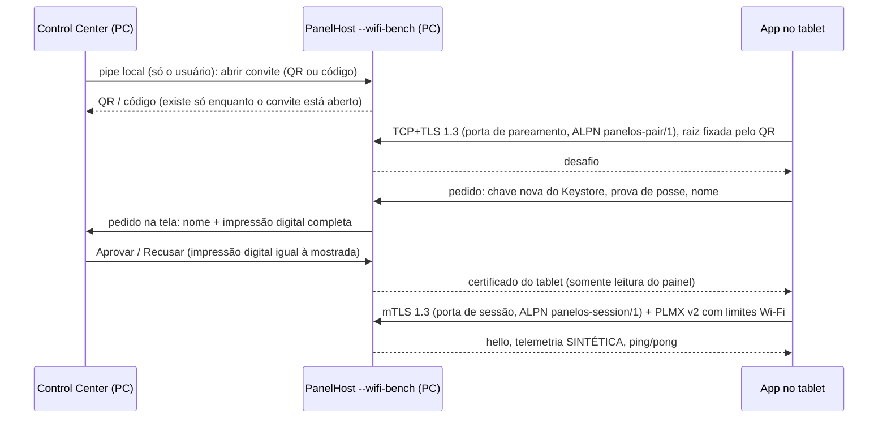

# Wi-Fi com o tablet: pareamento e a primeira janela (nunca executada)

Base: branch de tarefa. Este documento descreve o que foi construído até o tablet e o roteiro
proposto para a primeira janela com ele. **Nada aqui foi executado na LAN, no tablet ou com a câmera.** O que foi
provado está em "O que foi provado" e o que não foi, em "Não comprovado".

Adaptação Android 9: [provedor, Keystore e teste API 28](wifi-android9.md). O APK anterior tinha 17 493 604 bytes;
o atual tem 28 200 765 bytes (+10 707 161), incluindo Conscrypt Android 2.9.0 para quatro ABIs, com armeabi-v7a.

## O que existe



| Peça | Onde |
|---|---|
| Convite `PanelOSPair/1`: uso único, 10 minutos, cinco tentativas inválidas, aprovação local em até 60 s | `WifiPairingSession` (PanelHost) |
| Modo PIN / código digitado (100 caracteres Base32, com o host id completo) | `WifiTypedCode` (PanelHost e app, mesma fixture) |
| Canal Control Center ⇄ PanelHost: pipe `PanelOS.Wifi.Admin.v1`, só o usuário, pedido e resposta de uma linha | `WifiAdminProtocol`, `WifiAdminPipeServer` |
| Página **Wi-Fi** do Control Center: QR, código, pedido com a impressão digital, lista, revogar | `WifiPairingViewModel`, `WifiView` |
| Cliente de pareamento no app: chave nova num alias temporário (o pareamento antigo só é trocado depois da aprovação), `expiresAt` conferido ("QR expirado") | `WifiPairingClient`, `AndroidWifiIdentity` |
| Transporte Wi-Fi do app (mTLS + PLMX), pausa em recusa permanente | `WifiTransport` |
| Controlador (parear, ligar/desligar, esquecer, motivo da recusa) | `WifiController` |
| Tela de Configurações com a seção "Conexão com o PC" e tela de pareamento com câmera ou código | `WifiSettingsSection`, `WifiPairActivity` |

Só vale dentro de uma janela `--wifi-bench` com `--wifi-pair-port`. Sem essa janela a página do Control Center diz que o
Wi-Fi está desligado, nada escuta na rede e o cabo continua sendo o único caminho. Dentro da janela o tablet vê o
painel **sintético** (nome do host "PanelOS WiFi bench" e uma CPU "Synthetic bench; sensors unavailable"), sem Desktop,
sem Stream Deck, sem toque e sem controle do PC.

## Decisões do mantenedor e desvios do contrato (para a revisão de segurança)

- **Validade do convite: 10 minutos** (o desenho original dizia 120 s), uso único; a oferta de bancada também. Em
  `WifiPairingInvitation.LifetimeSeconds`. A aprovação continua em até 60 s e as cinco tentativas inválidas continuam.
- **A identidade do PC fica guardada** depois do teste (`%LOCALAPPDATA%\PanelOS\Wifi`). As chaves dela têm o prefixo CNG
  `PanelOS-Wifi-`; **os testes usam outro prefixo, `PanelOS-WifiTest-`** (`WifiIdentityStore.TestKeyPrefix`), e o código recusa criar
  chaves de prefixo errado para o diretório (real × teste). Nenhuma limpeza por `PanelOS-Wifi-*` apaga chave de teste e nenhuma
  limpeza de teste toca a identidade real. Mesmo assim: sem testes nem mutação em paralelo nesta conta durante a janela.
- **A conta do Windows é a fronteira de confiança** do pipe Control Center ⇄ PanelHost: qualquer processo da mesma conta lê o
  QR e o código e pode aprovar ou revogar (contrato `seguranca-wifi.md`, seção "Fronteira de confiança do canal administrativo").
- **Código digitado = modo PIN do contrato 5.2, com uma diferença**: como a raiz não vem num QR, o host a manda na primeira
  mensagem do fio e o app valida o certificado do servidor **depois** do aperto de mão TLS e **antes** de enviar qualquer
  coisa. A raiz tem de ter hash igual ao host id digitado (256 bits completos) e o certificado tem de encadear nela com o
  nome esperado; se não, o app fecha e não envia o PIN nem o pedido. O contrato original só descreve a validação durante
  o aperto de mão; aqui ela é adiada porque o Windows não envia a cadeia (`seguranca-wifi.md`, delta da raiz). Teste:
  `Pin_mode_with_a_wrong_pin_fails_and_with_a_wrong_host_id_aborts_before_any_request` e
  `pinModeAbortsBeforeSendingTheTokenWhenTheHostIdIsNotThePcThatAnswers`.
- **Chave do Keystore com `DIGEST_SHA256` e `DIGEST_NONE`**: o TLS da plataforma assina o aperto de mão com o digest já
  calculado. Sem `NONE`, o mTLS falharia no aparelho. É suposição baseada no comportamento conhecido do Conscrypt, **não
  comprovada no tablet**.
- **Dependências novas**, a revisar: ZXing core 3.5.4 (Apache-2.0, decodificação), CameraX 1.6.2 (Apache-2.0, câmera) e
  QRCoder 1.6.0 (MIT, só a matriz do QR no Control Center). Permissões novas: `CAMERA` (pedida só ao escanear) e
  `ACCESS_LOCAL_NETWORK` (Android 17+; pedida só para Wi-Fi). Backup e transferência entre aparelhos excluem os dados do pareamento.

## O que foi provado

- PC: sessão de pareamento (aprovação, recusa, 60 s, 10 min, cinco inválidas, replay de prova, segundo aparelho, PIN, TLS
  1.2/ALPN errado, origem recusada, rótulo com direção de texto) em sockets reais de `127.0.0.1` dentro da suíte.
- Control Center: ViewModel, QR (codificado com QRCoder, decodificado com ZXing na suíte Android) e layout da página.
- App: cliente de pareamento contra um host JSSE real e **contra o host .NET real** (`scripts/run-cross-language-wifi-pairing.ps1`),
  seguido de mTLS 1.3 e da sessão do app (`TransportPanelConnection`) por 17 s, mais que os 15 s de heartbeat do host, sem
  nenhuma recusa no host.
- Lint, testes JVM e .NET completos e o APK compilado (sem instalar).

## Não comprovado

Câmera real, leitura do QR de um monitor, AndroidKeyStore e Conscrypt no tablet (a prova usou JSSE e chaves em
software), `DIGEST_NONE`, o AndroidKeyStore/Conscrypt físicos do tablet, `ACCESS_LOCAL_NETWORK`, bind/WMI/firewall na
LAN, a CLI `--wifi-bench` com `--wifi-pair-port` ponta a ponta, o comportamento em segundo plano, bloqueio e suspensão.
O ensaio físico é exatamente o que fecha isso.

## Pré-requisitos e aprovações (do mantenedor)

1. Tablet **de teste, Android 9/API 28**: leitura `getprop` relatada pela coordenação,
   autorizada pelo mantenedor; não houve acesso ao tablet. O Wi-Fi exige **API 28+**, com Conscrypt 2.9.0 empacotado e
   sem provedor global. Abaixo disso, o app explica que precisa do Android 9; o cabo continua igual.
2. Rede de casa `192.168.15.0/24`; PC em `192.168.15.4` na interface `Ethernet` (conferida só por leitura: física, Up,
   Private, /24); o tablet na mesma rede. **A interface `vEthernet` do WSL não é usada.** Janela no mesmo PC foi cancelada.
3. Parar o PanelHost de produção (PID do processo em uso) durante a janela e religá-lo depois; cabo desconectado e retestado depois.
4. Uma elevação só para criar e remover as regras de firewall (o PanelHost nunca eleva).
5. **Instalar o APK no tablet é uma etapa à parte**, com autorização própria (ADB ou cópia do arquivo). APK compilado:
   `app\build\outputs\apk\debug\app-debug.apk`, 28 200 765 bytes, SHA-256
   `C3E0CE4AFEC6E601E1E4D9DC9E2B90558DF58E1C51EB56C1B8B95869F12BCEE4` (APK de debug, depurável: só para a bancada). Conferir o hash antes de instalar.
6. Quem opera: uma pessoa ao lado do tablet e do PC.

## Roteiro proposto (ainda não autorizado)

**A. Preparação, sem rede (pode ser feita antes):**

1. `PanelHost.exe --wifi-bench-init` se a identidade ainda não existe (ela é guardada entre janelas). Anotar o host id.
2. Abrir o Control Center (mesma conta do Windows, sem elevação). A página **Wi-Fi** deve dizer "O Wi-Fi está desligado".
3. Rodar `scripts\wifi-bench-preflight.ps1 -BindIp 192.168.15.4 -InterfaceAlias Ethernet -Port 40001`
   e de novo com `-Port 40002` (só leitura). Deve terminar em `PREFLIGHT PASS`.

**B. Firewall (só depois da aprovação; elevação apenas para estes comandos):**

```powershell
$benchIp = '192.168.15.4'; $benchCidr = '192.168.15.0/24'; $benchInterface = 'Ethernet'
$benchExecutable = '<raiz-do-repositorio>\windows\PanelHost\bin\Debug\net8.0-windows10.0.19041.0\PanelHost.exe'
$benchGroup = 'PanelOS-Wifi-Bench'
(Get-FileHash -Algorithm SHA256 -LiteralPath $benchExecutable).Hash   # esperado: C851AC265D29D6C0493D86EBE132EAD8D024D70BF8E6FF54B1DB132DE0E3FD0B (build final; refazer se recompilar)
foreach ($rule in @(@{ Name = 'PanelOS-Wifi-Bench-Pair'; Port = 40001 }, @{ Name = 'PanelOS-Wifi-Bench-Session'; Port = 40002 })) {
  New-NetFirewallRule -Name $rule.Name -DisplayName $rule.Name -Group $benchGroup -Direction Inbound -Action Allow `
    -Program $benchExecutable -Protocol TCP -LocalAddress $benchIp -LocalPort $rule.Port -RemoteAddress $benchCidr `
    -Profile Private -InterfaceAlias $benchInterface -EdgeTraversalPolicy Block
}
```

Este arquivo **não cria** as regras; o bloco só existe para revisão.

**C. Janela (proposta: 600 s; 300 s bastam se for só o caminho feliz), sem tablet no cabo:**

1. Parar o PID do processo em uso (com autorização), desconectar o cabo, confirmar `Get-Process PanelHost` vazio.
2. Terminal não elevado:
   ```powershell
   & $benchExecutable --wifi-bench --wifi-bind 192.168.15.4 --wifi-session-port 40002 --wifi-pair-port 40001 --wifi-window-seconds 600 --wifi-cable-disconnected
   ```
   Se o Windows mostrar "Permitir acesso", clicar em **Cancelar** e encerrar a janela.
3. No Control Center, página **Wi-Fi** → deve mostrar a janela aberta e o endereço. Tocar em **Adicionar aparelho**: aparece o QR.
   O QR aparece ao lado das instruções, com módulos de pixels físicos inteiros (4, ou 5 se couber); **Ampliar** mostra o QR
   em tela cheia (Esc volta). O log do app (`adb logcat -s PanelWifiQr`, só se você autorizar o ADB) diz a **resolução real da análise
   da câmera** ("QR analysis resolution=..."); o pedido é de no mínimo 1280×720.
4. No tablet: Configurações (o botão de Configurações do painel) → **Conexão com o PC** → **Parear com um PC** → permitir a câmera →
   apontar para o QR (a ~30 cm). O tablet mostra "Aprove no PC", os quatro passos, "Restam 0:xx" e a impressão digital da chave
   dele em 2 linhas de 4 blocos. Um QR de outro sistema só dá o aviso "Esse QR não é do PanelOS." e a câmera continua lendo.
5. No Control Center aparece, no lugar do QR, o cartão "Aprovar este aparelho?" com o nome do tablet, a impressão digital
   **inteira** (2×4 blocos, maiúsculas) e uma barra de 60 s; o item **Wi-Fi** do menu ganha um ponto e o botão da barra de tarefas
   pisca se a janela estiver atrás. A página mostra também a impressão digital **deste PC**; ela deve ser igual à que o tablet mostra
   para o PC em Configurações. Conferir bloco por bloco e tocar em **Aprovar** (em até 60 s). **Recusar** é um botão neutro.
6. O tablet diz "Pareado. Conectando por Wi-Fi…" e fecha a tela em 2 s. Em Configurações: **Caminho em uso: Wi-Fi** (com ✓),
   o interruptor **Usar Wi-Fi** com o resumo "Conectado" e a impressão digital do PC. A notificação do serviço mostra "Wi-Fi" no subtexto e
   "Conectado por Wi-Fi". O painel mostra dados sintéticos. No Control Center o aparelho aparece **Conectado**.
7. Variações, uma a uma, sem repetir rápido (o host aceita 12 conexões por minuto):
   - **Recusar** num novo convite: o tablet diz que o PC recusou; nenhuma chave sobra.
   - **Usar código digitado**: no tablet, **Digitar código** (grupos de 5, contador "37 de 100", **Parear** só com 100 caracteres válidos).
     Parear de novo no mesmo PC só substitui o pareamento antigo **se o novo for aprovado**; se falhar, o antigo continua valendo.
   - **Revogar** no Control Center com o tablet conectado: o tablet cai em até ~1 s e passa a mostrar que o PC recusou.
   - Desligar o interruptor **Usar Wi-Fi** no tablet: o cabo volta a ser o caminho (desconectado, então "aguardando").
   - **Esquecer este PC** no tablet (local): apaga a chave e o pareamento; o registro no PC só some ao **Revogar**.
8. Ao fim da janela o host imprime a linha de contadores; os pares usados na janela são revogados.

**D. Depois (mesmo após falha):** remover as regras (`Remove-NetFirewallRule -Group 'PanelOS-Wifi-Bench'`), conferir que não
sobrou regra automática para o PanelHost, comparar o hash do executável, religar o PanelHost de produção, reconectar e
retestar o cabo. No tablet: **Esquecer este PC** se não for reaproveitar.

**Critérios de sucesso:** pareamento por QR e por código; aprovação só com a impressão digital igual nos dois lados;
recusa e revogação efetivas; conexão por mTLS estável por pelo menos 60 s (o heartbeat de 15 s do host prova que o app
mantém o enlace); motivo legível em cada falha; cabo preservado e retestado; sem regra de firewall sobrando; saída limpa.

**Se algo falhar:** Android < 9 (texto "O Wi-Fi seguro precisa do Android 9…"), câmera sem foco (usar o código digitado), mensagem
"O PC recusou este tablet" logo após aprovar (suspeitar de `DIGEST_NONE`/Conscrypt: registrar `tls_other` e
`protocol_refused` da linha de contadores e parar), "Não achei o PC" (regra de firewall, perfil de rede ou janela
fechada). Nunca aceitar um certificado "para facilitar" e nunca mudar o perfil da rede para Private.

## Rodada final antes da primeira janela (13/11/2026)

Alterações pedidas pela revisão de segurança (K1, K3), revisão de UX e revisão independente: prefixo de chaves de teste, câmera ≥ 1280×720, cartão de aprovação,
QR em pixels físicos, tela do tablet, notificação por caminho, impressão digital 2×4 nos dois lados, pareamento antigo preservado, "QR expirado", "tablet desistiu" e "limite de aparelhos atingido" no Control Center. **Não feitos:** a linha "Conexão com o tablet" da Visão geral (a revisão de UX permite entregar sem), o lock de dependências (K2: Gradle erification-metadata.xml e lock do NuGet) e abrir direto a seção Conexão com o PC ao tocar na notificação de Wi-Fi pausado. O teste do Service no cabo sem pareamento é um teste JVM da decisão de início (CarrierStartCoordinatorTest); um teste instrumentado do Service real não foi escrito nem rodado (sem ADB).
